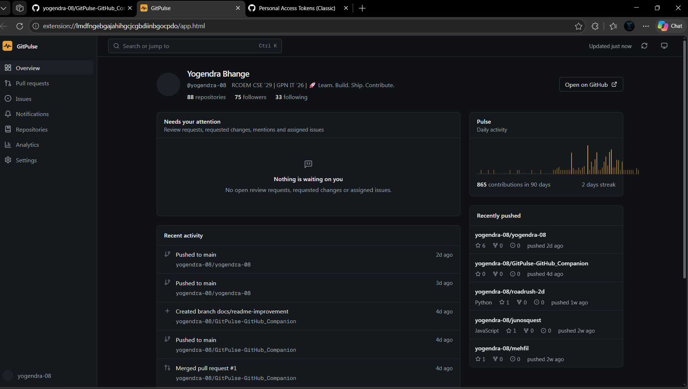
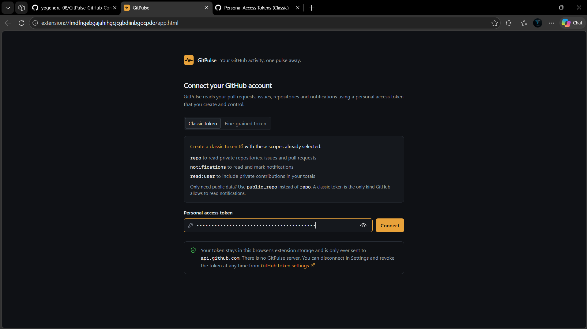
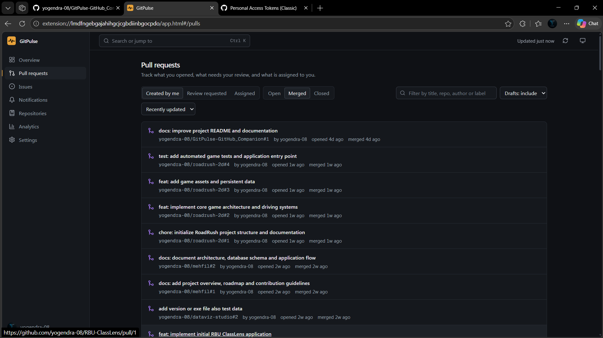
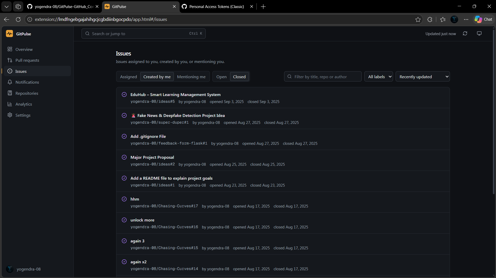
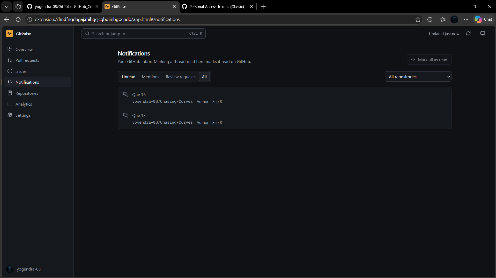
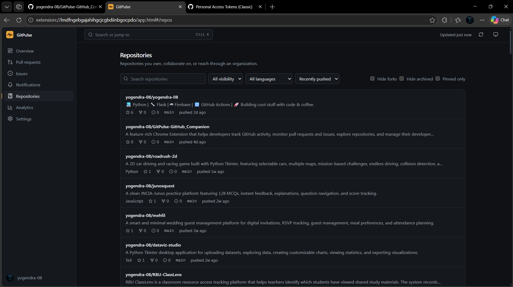
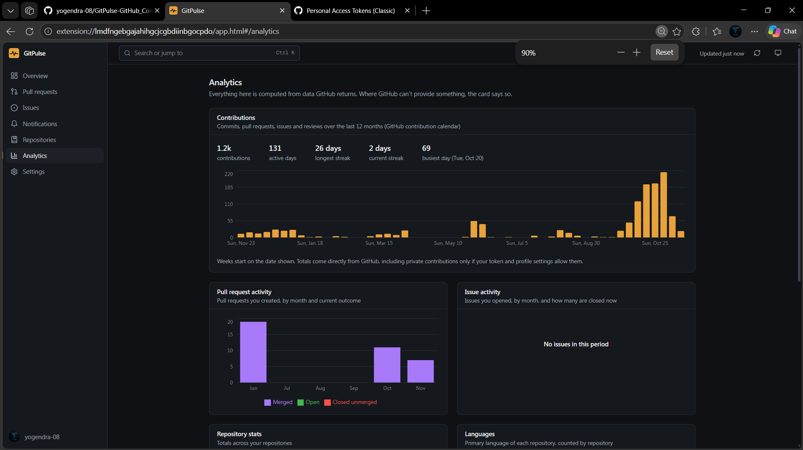

<div align="center">

# GitPulse – GitHub Companion

**Your GitHub activity, one pulse away.**

A Manifest V3 Chrome extension that brings your pull requests, issues, notifications, repositories and activity analytics into one dashboard.


[Download latest release](https://github.com/yogendra-08/GitPulse-GitHub_Companion/releases) · [Run from source](#-run-from-source) · [Report an issue](https://github.com/yogendra-08/GitPulse-GitHub_Companion/issues)

<br />



</div>

---

## 📖 Introduction

Answering "what needs me right now?" on GitHub usually means visiting the Pull requests page, the Issues page, the notification inbox and a few repositories. GitPulse puts those signals in one place.

It runs entirely in your browser and talks directly to the GitHub API with a personal access token that you create. There is no GitPulse server.

## ✨ Features

- **Developer overview**: profile summary, a ranked "needs your attention" list (requested changes, review requests, mentions, assigned issues), recent activity, a daily activity strip and pinned repositories.
- **Pull request tracking**: pull requests you created, that need your review, or that are assigned to you, in open, merged and closed states. Draft and text filters, sorting, and review status (approved, changes requested, commented) for your open pull requests.
- **Issue tracking**: issues assigned to you, created by you, or mentioning you. Label filter, sorting, and a *Stale* badge for open issues with no update in 30+ days.
- **GitHub notifications**: unread, mentions, review requests and all notifications, with a repository filter. Mark as read, mark as done, or mark everything as read. A background worker can update the toolbar badge and show desktop alerts (configurable in Settings).
- **Repository explorer**: search, filter by visibility and language, sort, hide forks or archived repositories, and pin favorites.
- **Developer analytics**: contribution calendar with streaks, pull request and issue activity by month, repository statistics, language mix and recent event mix.
- **Themes**: dark, light and system.
- **Command palette and keyboard shortcuts**: `Ctrl/Cmd + K` to jump anywhere, plus shortcuts for navigation, refresh and theme.
- **Settings and customization**: notification behavior, polling interval, theme, which Overview sections to show, pinned repositories and cache clearing.
- **Error handling and loading states**: skeleton loaders, empty states, retry actions, rate-limit and expired-token messages, and cached data that is shown while fresh data loads.

### Data you can trust

GitPulse is careful about what its charts mean:

- Language share is the **primary language per repository, counted by repository**, not bytes of code. Repositories without a detected language are reported separately.
- Monthly pull request and issue charts use the 100 most recent items. If GitHub has more, earlier months are omitted and the chart says so.
- The event mix counts **pushes**, not individual commits.
- If the contribution calendar cannot be loaded, the activity strip falls back to GitHub's events feed and labels it as such.

## 🖼️ Screenshots

| Start screen | Overview |
| :---: | :---: |
|  |  |

| Pull requests | Issues |
| :---: | :---: |
|  |  |

| Notifications | Repositories |
| :---: | :---: |
|  |  |

| Analytics |
| :---: |
|  |

## 🧰 Tech stack

| Area | Technology |
| --- | --- |
| UI | React 18, React Router (hash routing), Recharts, lucide-react |
| Language | TypeScript (strict mode) |
| Build | Vite 5 |
| Styling | Tailwind CSS 3, Geist fonts (bundled, no network fonts) |
| Extension | Chrome Extension Manifest V3, Chrome Storage API, Alarms and Notifications APIs |
| Data | GitHub REST API (plus one GraphQL query for the contribution calendar) |
| Testing | Vitest |

## 🏗️ Architecture overview

GitPulse has four extension surfaces:

| Surface | File | Purpose |
| --- | --- | --- |
| Popup | `popup.html` | Quick glance: attention items, pull requests, issues, inbox, repositories |
| Dashboard | `app.html` | The full application in a browser tab |
| Options | `options.html` | Settings page |
| Service worker | `background.js` (from `src/background/`) | Polls notifications, updates the toolbar badge, raises desktop alerts |

Design decisions:

- **Shared, DOM-free core.** `src/shared/` contains the GitHub client, API functions, storage, cache and notification helpers. Both the UI and the service worker use it.
- **Stale-while-revalidate caching.** Responses are cached in `chrome.storage.local`. Cached data renders immediately and is refreshed when it is older than its time-to-live or when you refresh. Concurrent identical requests are de-duplicated, and a failed refresh keeps showing saved data with a retry option.
- **Cheap background polling.** The worker sends `If-Modified-Since` to the notifications endpoint so unchanged checks return `304 Not Modified`.
- **Setup happens in the dashboard.** The popup closes when you switch tabs, which would discard a half-typed token while you create one on GitHub.

## 📦 Installation

### Method A: Install the ready-to-use build

1. Open the [GitHub Releases page](https://github.com/yogendra-08/GitPulse-GitHub_Companion/releases).
2. Download the latest GitPulse Chrome ZIP (for example `GitPulse-v1.0.0-chrome.zip`) from the release assets.
3. Extract the ZIP.
4. Open `chrome://extensions` in Chrome.
5. Enable **Developer mode**.
6. Click **Load unpacked**.
7. Select the extracted folder that contains `manifest.json`.

Pin GitPulse to the toolbar to use the popup. The minimum supported Chrome version is 116.

### 🛠️ Run from source

Requires Node.js 18 or newer.

```bash
git clone https://github.com/yogendra-08/GitPulse-GitHub_Companion.git
cd GitPulse-GitHub_Companion
npm install
npm run dev
```

`npm run dev` starts the Vite dev server so you can work on the interface in a normal browser tab. Outside Chrome there is no `chrome.*` API, so storage falls back to `localStorage` and the background worker does not run.

To test the real extension, build it and load the output:

```bash
npm run build
```

Then open `chrome://extensions`, enable **Developer mode**, click **Load unpacked**, and select the generated `dist/` folder. After each rebuild, click the reload icon on the extension card.

### Available scripts

| Command | Description |
| --- | --- |
| `npm run dev` | Start the Vite development server |
| `npm run build` | Type-check, then create the production build in `dist/` |
| `npm run typecheck` | Run the TypeScript compiler without emitting files |
| `npm run test` | Run the Vitest test suite once |
| `npm run package` | Build, then zip the contents of `dist/` into the `release/` folder |

Also available: `npm run test:watch` and `npm run icons` (regenerates the icons; requires Python 3 and Pillow).

More detail is in [DEVELOPMENT.md](DEVELOPMENT.md).

## 🔐 GitHub authentication setup

GitPulse signs in with a **GitHub Personal Access Token**. When you open the dashboard for the first time, paste your token on the start screen and GitPulse verifies it against GitHub before saving it.

Create a dedicated token for GitPulse rather than reusing one from another tool.

| | Classic token (recommended) | Fine-grained token |
| --- | --- | --- |
| Permissions | `repo`, `notifications`, `read:user` (use `public_repo` instead of `repo` for public data only) | Metadata: read, Issues: read, Pull requests: read |
| Notifications page, badge and alerts | ✅ Supported | ❌ Not supported |
| Scope | Everything your account can access | One user or organization, only the repositories you select |

- [Create a classic token with the scopes preselected](https://github.com/settings/tokens/new?scopes=repo,notifications,read:user&description=GitPulse)
- [Create a fine-grained token](https://github.com/settings/personal-access-tokens/new)

**Notification limitation:** GitHub's notifications API does not accept fine-grained tokens. If you connect one, GitPulse turns off the Notifications page, toolbar badge and desktop alerts and explains why. Use a classic token with the `notifications` (or `repo`) scope to enable them.

To disconnect, use **Settings → Disconnect** in GitPulse. This removes the token and cached data from your browser. To fully revoke the token, delete it in your [GitHub token settings](https://github.com/settings/tokens).

## 🔒 Security considerations

- GitPulse stores your token in **Chrome extension storage** (`chrome.storage.local`) on your device.
- **Chrome extension storage is not automatically encrypted.** Treat the token like any other local credential, and set an expiration date when you create it.
- The token is sent in the `Authorization` header of requests to `api.github.com`, and nowhere else. The extension's content security policy limits network requests from extension pages to `https://api.github.com`.
- Create a **dedicated token with the minimum permissions** you need. A classic `repo` scope is broad: GitPulse only reads data, apart from the notification actions you trigger (mark as read, mark as done, mark all as read). If that is too much access, use a fine-grained token and accept the loss of notifications.
- **Never share your token or commit it to a repository.** No token or secret is included in this source code.
- Desktop alert clicks only open `https://github.com/...` links.
- If GitHub rejects the token (revoked or expired), GitPulse asks you to reconnect.

### Permissions requested

| Permission | Why it is needed |
| --- | --- |
| `storage` | Save your token, settings and cached responses locally |
| `alarms` | Schedule the background notification check |
| `notifications` | Show desktop alerts for new GitHub notifications (can be turned off) |
| `https://api.github.com/*` | Call the GitHub API |

GitPulse does not request access to your browsing history, tabs or all websites, and it has no content scripts.

## 📁 Project structure

```text
GitPulse-GitHub_Companion/
├── docs/
│   └── screenshots/        # README screenshots
├── public/
│   ├── icons/              # Extension icons
│   └── manifest.json       # Manifest V3 configuration
├── scripts/
│   ├── generate-icons.py   # Icon generation
│   └── package.mjs         # Zips dist/ into release/
├── src/
│   ├── app/                # Dashboard shell, routing, navigation
│   ├── background/         # Service worker: polling, badge, desktop alerts
│   ├── components/         # UI primitives, list rows, command palette
│   ├── features/           # Auth and settings providers, data hooks
│   ├── hooks/              # Query cache, hotkeys, theme, chart colors
│   ├── lib/                # Pure logic (filters, queries, statistics)
│   ├── options/            # Options page entry
│   ├── pages/              # Overview, Pull requests, Issues, Notifications,
│   │                       # Repositories, Analytics, Settings
│   ├── popup/              # Popup entry and UI
│   ├── shared/             # GitHub client, API, storage, cache (no DOM code)
│   ├── styles/             # Design tokens and Tailwind layers
│   └── test/               # Smoke tests
├── app.html                # Dashboard entry
├── options.html            # Options entry
├── popup.html              # Popup entry
├── DEVELOPMENT.md
├── LICENSE
├── package.json
├── package-lock.json
├── postcss.config.js
├── tailwind.config.js
├── tsconfig.json
└── vite.config.ts
```

## ⌨️ Keyboard shortcuts

| Shortcut | Action |
| --- | --- |
| `Ctrl/Cmd + K` | Open the command palette |
| `/` | Focus the search box on the current page |
| `g` then `o` `p` `i` `n` `r` `a` `s` | Go to Overview, Pull requests, Issues, Notifications, Repositories, Analytics, Settings |
| `r` | Refresh all data |
| `t` | Change theme |

Shortcuts are ignored while you are typing in an input.

## ⚠️ Known limitations

- Review status needs one API request per pull request, so it is shown for at most 20 open pull requests at a time.
- Search-based lists (pull requests and issues) show GitHub's 100 most recent results per view.
- The contribution calendar uses GraphQL. Some fine-grained token configurations may not allow it; GitPulse then says so and falls back to the events feed.
- Notifications require a classic token (a GitHub API restriction).
- GitHub Enterprise Server is not supported.
- Chrome extension storage is not encrypted (see [Security considerations](#-security-considerations)).

## 🗺️ Future improvements

- GitHub OAuth Device Flow as an alternative to personal access tokens
- A Chrome side panel
- GitHub Enterprise Server support
- Per-repository notification rules
- GitHub Actions run status
- Saved searches
- Chrome Web Store listing

These are ideas, not commitments.

## 🤝 Contributing

Contributions are welcome.

1. Fork the repository and create a branch for your change.
2. Run `npm install`, then make your changes.
3. Run `npm run typecheck` and `npm run test` before opening a pull request.
4. Keep UI changes consistent with the existing components in `src/components/ui` and the design tokens in `src/styles/index.css`.
5. Add tests for new logic in `src/lib` or `src/shared`.
6. Do not add dependencies or extension permissions without explaining why in the pull request.

Found a bug or have an idea? [Open an issue](https://github.com/yogendra-08/GitPulse-GitHub_Companion/issues).

## 📄 License

Released under the [MIT License](LICENSE).

## 👤 Author

Built by **Yogendra**.

- Repository: [yogendra-08/GitPulse-GitHub_Companion](https://github.com/yogendra-08/GitPulse-GitHub_Companion)
- GitHub profile: [@yogendra-08](https://github.com/yogendra-08)